# MatchDesk
## Explainable football intelligence, with the producer in control

MatchDesk is my project for the Inside the Game hackathon. I am building it around a
simple question: **how can a producer turn football events into a story they can actually check?**

My priority is the path from a synthetic match event to a publishable explanation.
The design keeps statistics in deterministic code, uses specialist AI agents to
interpret and present evidence, and gives the producer control over publication.

**Owner: George Okwori. Current stage: competition build, hosted at https://matchdesk-seven.vercel.app. The submission build is `release/submission-2026-10`; see the [competition build record](docs/evidence/competition-build-20261021.md).**

What runs today, on one invented match (Northbridge FC 2–1 Riverside United, 1,421
synthetic events):

- Four specialist agents (Tactical Analyst, Narrative Composer, Editorial Reviewer,
  Audience Adapter) run end to end through role-scoped, traced tools. AI insights
  replays a live run recorded on Microsoft Foundry, step by step, beside the
  deterministic rehearsal.
- Every claim is recomputed from the event log, and the sentence itself is checked: it
  must name its subject and state the number it asserts. A failed claim goes back to
  the composer. The same verifier runs, ported exactly, in the browser.
- The studio has a seven-stop guided tour, a "try to fool the verifier" panel, and a
  composer that re-verifies a sentence as you edit it.
- Producer approval and publishing are not enabled; there is no deployed or
  authenticated publishing service. Start with the [judging guide](docs/competition/judging-guide.md).

## What is implemented

The deterministic football engine now includes a seeded synthetic simulator,
ordered/idempotent replay ingestion, roster/score/possession reduction, fourteen registered
metric formulas and five explicit moment detectors. The Python API still distinguishes
structural validation from factual verification, and immutable contracts cover claims,
evidence, verification results and approval bindings.

Phase 2A adds a typed control plane for four specialist roles: Tactical Analyst,
Narrative Composer, Editorial Reviewer and Audience Adapter. The controller owns role
order, retry limits, timeout classification, bounded recovery and the verification
hand-off. It does not call a model and it does not give an agent publishing authority.
Later Phase 2 slices add evidence verification, scoped specialists, one bounded
live Foundry invocation and tested retry/recovery and model-evaluation controls.

The submission build has 1,596 Python tests, a 92-case Python/TypeScript verifier
parity fixture and 186 studio browser tests (three viewports, axe on every page).
Ruff, formatting, strict mypy, frontend build, dependency audit and source security
run in hosted CI on every pull request.

Ask MatchDesk is a question box in the studio. It guides people round the app and
answers questions about the match, and it shows the proof for every figure. The engine
writes every number: each factual sentence is built as a claim and checked by the
parity-tested verifier before it is shown. An optional Foundry planner, off by default,
may only translate a free-form question into a query plan. See
[the design](docs/design/ask-matchdesk.md).

Live Intelligence replays the log at 1× to 60× with statistics recomputed as the clock
moves and timed broadcast overlays whose claims are re-verified in the browser before they
appear. The same cues are published as a machine-readable feed,
[`apps/web/public/overlays/nbr-riv.json`](apps/web/public/overlays/nbr-riv.json)
(schema `matchdesk-overlay-feed/1`, built by `matchdesk.domain.overlay_feed`), with every
persona (fan, analyst, caption), language (EN, ES, FR) and the full claim behind each
number. Viewers can pick a favourite club and player, a persona, a language and one focus
statistic; player-focus pages state each player's figures as verified sentences, and
Tactical Analysis labels each five-minute spell as control, chaos or contested by a
published rule, with the verified sentences that justify it.

PostgreSQL now has a reviewed producer-case migration, a pinned Psycopg driver,
real adapter qualification with a restricted disposable database role, atomic
audit/CAS/restart evidence, and independent validation of append-only audit rows
against the producer state snapshot. This does **not** qualify a production
database, Entra/OIDC authentication, host session grants or actual publication.
Independently accepted multilingual adaptations also remain outstanding.

Read [current progress](docs/PROGRESS.md) and the [evidence index](docs/evidence/INDEX.md)
before treating any capability as tested or available.

## Architecture

```mermaid
flowchart LR
    S[Seeded synthetic simulator - TESTED] --> I[Ingest and deterministic intelligence - TESTED]
    I --> E[Evidence and claim contracts - implemented]
    E --> C[Bounded four-specialist control plane - TESTED]
    C --> A[Agent Framework / Foundry workflow with traced tools - TESTED]
    A --> V[Claim and sentence verification, Python and browser - TESTED]
    V --> P[Producer review and exact-binding domain gate - TESTED]
    P --> O[Authenticated publishing - PLANNED]
```



The [solution design](docs/solution-design/02-architecture.md) explains the deterministic, specialist, verification and producer trust boundaries, plus the later authenticated publication path.

## Reproduce the foundation

The hosted qualification uses Python 3.12.15, Node 22.16.0, npm 10.9.2 and uv 0.10.0.
Install these tools first, then reproduce the committed locks rather than generating
new dependency versions during setup. These instructions remain for isolated
development, not an approved production deployment:

```bash
make setup
uv run --no-sync make foundation
uv run --no-sync make lint
cd apps/web && npm run build
```

If uv cannot download Python 3.12.15 on your machine, run `make setup SETUP_PYTHON=3.12.13`
(or another 3.12 patch release uv offers); the lock is reproduced unchanged.
`make setup` rejects a stale Python lock; `npm ci` rejects a mismatched npm lock.
`make resolve` is a separate maintenance operation. Review its dependency changes
and run the full checks before committing. The [initial compatibility decision](docs/decisions/ADR-0005-build-compatibility.md)
remains historical. The [patched ASGI decision](docs/decisions/ADR-0007-patched-asgi-dependencies.md)
and [test-client correction](docs/evidence/asgi-upgrade-first-run-20261008.md) explain
the current dependencies without weakening warnings, types or test assertions.

## Try the implemented API

From the repository root after setup:

```bash
uv run --no-sync make api
# In another terminal:
curl http://127.0.0.1:8000/api/health
```

The event schema is at `/api/contracts/event`. POST a JSON event to
`/api/contracts/event/validate`. The response explicitly says `evidence_verified: false`.
`/api/ready` remains intentionally fail-closed because durable persistence, live models and
publication are not operational. The structural validator must not be mistaken for a
verified or production football-intelligence service.

## Local container topology

```bash
python -m scripts.create_local_env
make dev
```

Use WSL2 or another POSIX shell with Docker. The environment generator creates a
local secret without printing or replacing it; do not commit `.env`. API and web
ports bind only to loopback, and PostgreSQL has no host port. New database volumes
initialise TCP authentication with SCRAM. Existing volumes need a separately reviewed
authentication migration; do not delete a database merely to apply these settings.

The standalone web image compiles its non-secret API upstream during the build.
Unused pip/npm/Yarn/Corepack are excluded from the final service images, not the
build stages. Image inventories and actual runtime/browser tests check the result;
The qualified native-image gate currently passes on the tested source. The
[integration method](docs/testing/integration-foundation.md) and
[image-security method](docs/testing/runtime-image-security.md) explain the scope.
No public demo is hosted yet.

## Tests, comments and documentation

`make foundation` runs regression tests, schema-drift checks, documentation link checks
and Python docstring-presence checks. `make lint` runs Ruff, formatting, strict mypy
and frontend type checks. Independent integration, advisory and source-security workflows
retain failures, source IDs, hashes, JUnit, screenshots, SARIF and redacted scan reports.
The [evidence index](docs/evidence/INDEX.md) separates historical image-security failures from later passing qualifications and the current Phase 3A/3B evidence.

Every authored Python module, class and function has a docstring. Non-obvious
validation, concurrency and security decisions have explanatory comments. Browser
helpers, controlled fixtures, container definitions and CI steps document their intent.
TypeScript includes compile-time regression checks for the platform declarations
used by Next.js. See the [coding standard](docs/engineering/coding-standard.md).

## Navigation

[Project specification](docs/project-specification.md) · [Project story](docs/project-story.md)
· [Testing strategy](docs/testing/test-strategy.md) · [Operations](docs/operations/runbook.md)
· [Requirements traceability](docs/competition/traceability-matrix.md)
· [Foundation merge checklist](docs/operations/foundation-merge-checklist.md)
· [Repository controls for review](docs/operations/repository-controls.md)

## Data, AI and licence

All supplied example data is invented. No real match footage, team branding or
player likeness is included. Synthetic xG is an illustrative estimate, not a
calibrated professional model. Runtime agents and their limits remain explicit in the
[responsible-AI design](docs/solution-design/12-responsible-ai.md). Bounded live Foundry calls have been tested via manually gated workflows; this is
not an always-on model service or a deployed public demo.

Original project source is provided under the [MIT licence](LICENSE).
