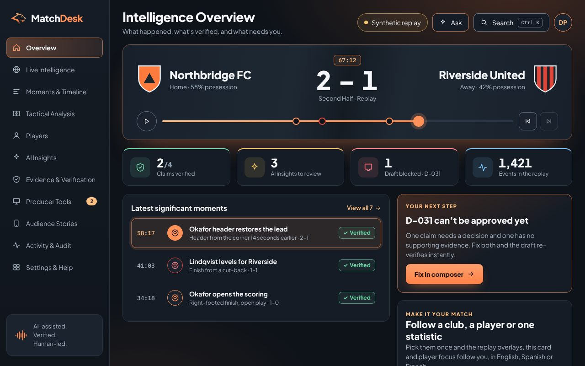
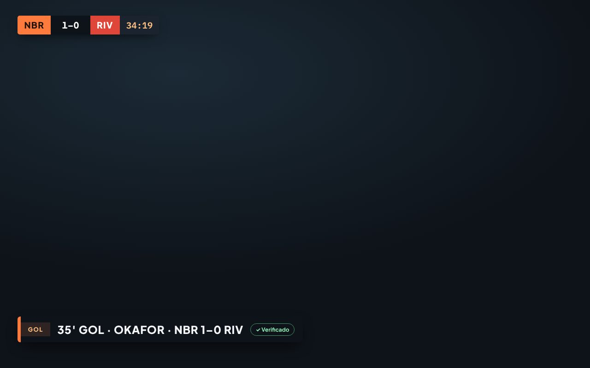
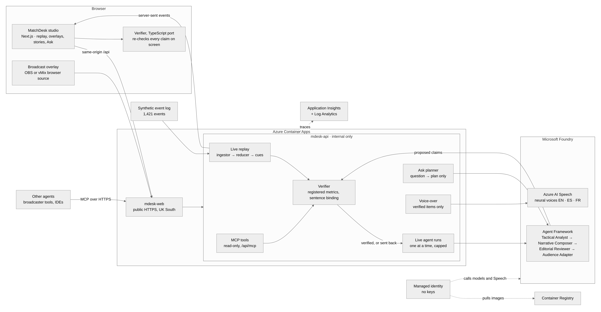
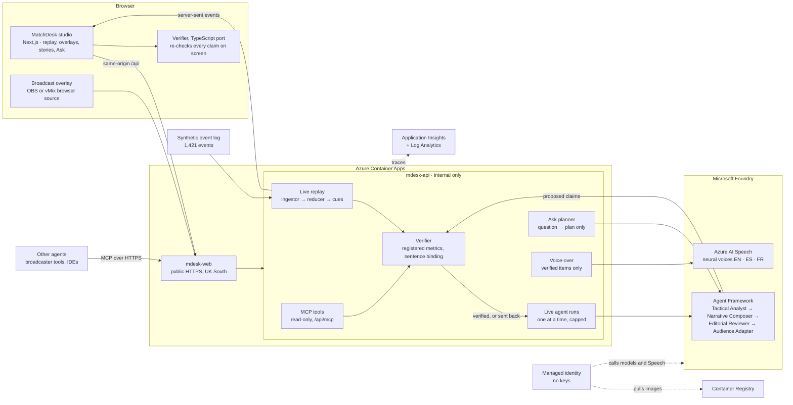
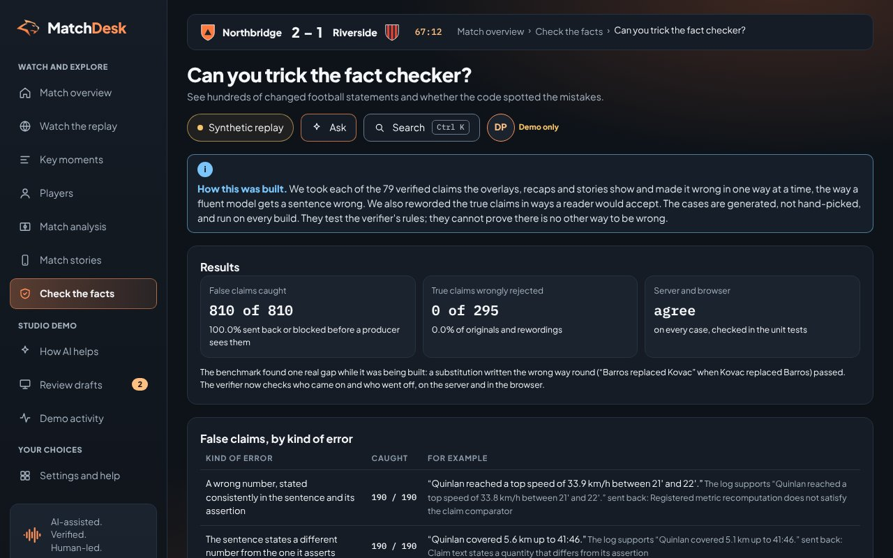

# MatchDesk

### AI agents draft the football story, code checks every claim, a producer decides

**Microsoft × Premier League "Inside the Game" hackathon entry · Category: Best Multi-Agent System · Prepared by George Okwori**

| | |
| --- | --- |
| **Live demo** | https://mdesk-web.icybeach-62467e8a.uksouth.azurecontainerapps.io (Azure Container Apps: the studio, the API, the live stream, live agent runs, MCP and voice-over) |
| **Video** | _Added with the submission_ |
| **Judges, start here** | [Judging guide](docs/competition/judging-guide.md) · [Pitch](docs/competition/pitch.md) · [Documentation map](docs/README.md) |

## Contents

1. [The problem and the idea](#1-the-problem-and-the-idea)
2. [Try it in three minutes](#2-try-it-in-three-minutes)
3. [How it works](#3-how-it-works)
4. [How it was built: timeline](#4-how-it-was-built-timeline)
5. [By the numbers](#5-by-the-numbers)
6. [What is real and what is synthetic](#6-what-is-real-and-what-is-synthetic)
7. [Documentation map](#7-documentation-map)
8. [Run it yourself](#8-run-it-yourself)
9. [Tools used](#9-tools-used)
10. [From demo to production](#10-from-demo-to-production)
11. [Authorship and AI assistance](#11-authorship-and-ai-assistance)
12. [Data and licence](#12-data-and-licence)

## 1. The problem and the idea

Broadcast and digital teams publish match statistics under time pressure. A wrong number or a
misattributed goal goes out in seconds and is corrected in public. A general-purpose AI makes
this worse: it writes fluent sentences that sound checked and are not.

MatchDesk separates writing from truth. Four specialist agents on Microsoft Foundry draft
overlays, recaps and fan stories. A deterministic verifier recomputes every number, and checks
every sentence, against the event log before anything is shown. Only a human producer can
approve and publish. The result is personalised for each viewer (club, player, focus statistic;
fan, analyst or caption style; English, Spanish or French) and can be read aloud.



### Choose what you want to explore

- **Football fans:** Start at **Match overview**, open **Watch the replay**, pick **Key moments** or **Players**, and read **Match stories**.
- **Producers (demo):** Open **How AI helps**, **Check the facts**, **Review drafts** and **Try demo publishing**. All approvals and sends in this public demo are simulated in the browser.
- **Judges and developers:** Explore the fact-checking benchmark, read-only MCP tools, broadcast overlay, and optional video-detection experiment.

No real producer account is signed in, and the public demo does not publish to live channels.

## 2. Try it in three minutes

1. **Match overview › Can you trick the fact checker?** Claim 59% possession; the log says 57.96% and the
   claim is rejected. Then open the [benchmark](docs/evidence/verifier-benchmark-20261024.md):
   810 false claims, all caught.
2. **Watch the replay.** Stream the match from the API at up to 60×. Each overlay is verified on
   the server on the events received so far, and again in your browser. Switch to Español or the
   caption style, turn on **Read overlays aloud**, or open the **broadcast overlay** that OBS or
   vMix can load.
3. **How AI helps › Run it live now.** Four agents on Microsoft Foundry. Watch the verifier send a
   claim back and the composer revise it (one live run every five minutes; a recorded run is
   always available).
4. **Match stories.** A fan story for every goal and an automated half-time recap, every
   figure verified, with **Listen** in three languages.
5. **Studio demo › Review drafts.** Try approving sample draft D-031 and sending it to pretend channels on this device; retry the
   destination that times out; edit the draft and watch the approval be withdrawn.
6. **Connect an agent.** Point an MCP client, such as GitHub Copilot in VS Code, at `/api/mcp` and
   ask it to check "Okafor scored 3 goals."



## 3. How it works

1. **Ingest.** Events arrive in order through an idempotent ingestor and a football-state reducer,
   streamed live from the API.
2. **Interpret.** Eighteen registered metrics run over the log (goals, shots, synthetic xG, pass
   quality, possession, defending, and synthetic tracking for shot speed, top speed, distance and
   sprints). Five deterministic detectors find the moments.
3. **Draft.** Four specialist agents built with Microsoft Agent Framework on Microsoft Foundry
   (Tactical Analyst, Narrative Composer, Editorial Reviewer, Audience Adapter) read the match
   through role-scoped tools and propose claims. No agent can approve or publish.
4. **Verify.** Code recomputes every claim from the event log with registered formulas, and checks
   that the sentence names its subject, statistic and time window and states the number it asserts.
   A failed claim goes back to the composer for a bounded revision. The same verifier runs, ported
   exactly, in the browser.
5. **Explain, render and speak.** Timed overlays, recaps and stories are built from verified
   values only; control, chaos and pressure changes are labelled by published rules. Azure AI
   Speech reads verified items aloud.
6. **Approve.** Only verified claims, or claims explicitly marked as opinion, reach a producer, who
   approves one exact version (bound to SHA-256 digests) before it can be published.



<details>
<summary>Diagram source (Mermaid)</summary>



</details>

The [solution design](docs/solution-design/02-architecture.md) explains each trust boundary; the
[agents and orchestration](docs/solution-design/06-agents-and-orchestration.md) and
[verification](docs/solution-design/07-verification.md) chapters go deeper.

## 4. How it was built: timeline

| Date (2026) | Milestone | Where to read more |
| --- | --- | --- |
| 8 Oct | **Foundation.** Repository, contracts, CI, dependency and source-security gates, container images, solo-maintainer policy | [Hosted foundation](docs/evidence/hosted-foundation-20261008.md), [ADR-0010](docs/decisions/ADR-0010-solo-maintainer-approval.md) |
| 8–10 Oct | **Football engine.** Seeded synthetic match, ordered and idempotent ingestion, reducer, registered metrics, moment detectors | [Metrics](docs/solution-design/04-metrics.md), [Moment detection](docs/solution-design/05-moment-detection.md) |
| 9–11 Oct | **Agents and verifier.** Four-role control plane, deterministic verifier, scoped specialists, first live Foundry runs | [Agents](docs/solution-design/06-agents-and-orchestration.md), [Verification](docs/solution-design/07-verification.md) |
| 11–20 Oct | **Producer control and assurance.** Producer review domain, PostgreSQL compare-and-swap store, identity qualification, assurance hand-off | [Progress](docs/PROGRESS.md), [Assurance hand-off](docs/testing/issues-62-63-52-assurance-handoff-20261020.md) |
| 13–17 Oct | **Studio.** Sunset Studio design, 14 screens, locked design rebuild and hardening, WCAG 2.2 audit | [Design](docs/design/README.md), [Accessibility audit](docs/evidence/studio-wcag22-audit-20261022.md) |
| 21–22 Oct | **Competition build.** Guided tour, "try to fool the verifier", composer, Ask MatchDesk, recorded live Foundry runs | [Build record](docs/evidence/competition-build-20261022.md) |
| 23 Oct | **Azure and live features.** Container Apps deployment, live stream, Application Insights, fan stories, automated recaps, MCP, tracking metrics, cards and substitutions, demo approval, auto-eventing lab, Spanish and French review | [Azure deployment](docs/evidence/azure-deployment-20261023.md), [Live checks](docs/evidence/release-live-checks-20261023.md), [Language review](docs/evidence/language-review-es-fr-20261023.md) |
| 24 Oct | **Proof and reach.** Verifier benchmark, broadcast overlay, voice-over, documentation overhaul | [Benchmark](docs/evidence/verifier-benchmark-20261024.md) |

## 5. By the numbers

| | |
| --- | --- |
| False claims caught | **810 of 810**, built from the 79 claims the demo shows, each made wrong one way at a time ([benchmark](docs/evidence/verifier-benchmark-20261024.md)) |
| True claims wrongly rejected | **0 of 295**, the originals and rewordings a reader would accept |
| Server and browser verifiers | Agree on all 1,105 benchmark cases and 108 parity cases |
| Speed (one CPU in a build container) | The whole replay ingested, reduced and verified in about 0.4 s; each overlay or recap verified in about 1 ms (15 ms at most); all 79 claims re-verified in a browser engine in about 22 ms |
| Live agent runs on Foundry | 6 claims passed first time, 2 were sent back, 3 malformed answers were stopped before verification; no unverified claim reached an audience version |
| Tests | About 1,660 Python tests, 216 studio unit tests and about 250 browser tests on three screen sizes with axe accessibility checks; security and dependency checks on every pull request |



## 6. What is real and what is synthetic

| Part | Status |
| --- | --- |
| The match | Synthetic: one invented match (Northbridge FC 2–1 Riverside United), 1,421 events. No real teams, players or footage |
| Metrics, verifier, overlays, recaps, stories | Real code, deterministic, run on that match |
| The four agents and the Ask planner | Real, on Microsoft Foundry through Agent Framework; live runs are rate-limited |
| Voice-over | Azure AI Speech neural voices on the Azure demo; the device's own voice elsewhere |
| Tracking (shot speed, top speed, distance, sprints) | Modelled with the match, as a tracking provider would supply it; not measured from video |
| Auto-eventing | A detector reads events from a synthetic top-down video and is scored against the log |
| Spanish and French | Templates reviewed and corrected (77 corrections) and certified by the owner; no native-speaker sign-off |
| Producer approval and publishing | A demo in the browser: no sign-in, no real destination |

## 7. Documentation map

The full index is in [docs/README.md](docs/README.md). The most useful entry points:

| For | Read |
| --- | --- |
| Judging the entry | [Judging guide](docs/competition/judging-guide.md) · [Pitch](docs/competition/pitch.md) · [Demo script](docs/competition/demo-script.md) · [Requirements traceability](docs/competition/traceability-matrix.md) |
| Understanding the design | [Overview](docs/solution-design/01-overview.md) · [Architecture](docs/solution-design/02-architecture.md) · [Data model](docs/solution-design/03-data-model.md) · [Agents](docs/solution-design/06-agents-and-orchestration.md) · [Verification](docs/solution-design/07-verification.md) · [Responsible AI](docs/solution-design/12-responsible-ai.md) |
| Specific features | [Ask MatchDesk](docs/design/ask-matchdesk.md) · [MCP endpoint](docs/design/mcp.md) · [Auto-eventing lab](labs/auto_eventing/README.md) · [Language review](docs/testing/language-review-es-fr.md) |
| Decisions | [Architecture decision records](docs/decisions/) |
| Running and deploying | [Azure demo](docs/operations/azure-demo.md) · [Runbook](docs/operations/runbook.md) · [Cost](docs/operations/cost-estimate.md) · [Teardown](docs/operations/teardown.md) |
| Quality and evidence | [Test strategy](docs/testing/test-strategy.md) · [Evidence index](docs/evidence/INDEX.md) · [Progress log](docs/PROGRESS.md) |
| Contributing | [Coding standard](docs/engineering/coding-standard.md) · [Documentation standard](docs/engineering/documentation-standard.md) · [Development workflow](docs/engineering/development-workflow.md) · [Security policy](SECURITY.md) |

## 8. Run it yourself

The hosted checks use Python 3.12.15, Node 22.16.0, npm 10.9.2 and uv 0.10.0. Install these,
then reproduce the committed locks rather than resolving new versions:

```bash
make setup
uv run --no-sync make foundation   # tests, contract drift, documentation and docstring checks
uv run --no-sync make lint         # Ruff, formatting, strict mypy, frontend types
cd apps/web && npm run build
```

If uv cannot download Python 3.12.15, run `make setup SETUP_PYTHON=3.12.13` (or another 3.12
patch release); the lock is reproduced unchanged.

Run the API and check it:

```bash
uv run --no-sync make api
curl http://127.0.0.1:8000/api/health
```

Run the local container topology (WSL2 or another POSIX shell with Docker):

```bash
python -m scripts.create_local_env
make dev
```

The environment generator creates a local secret without printing it; do not commit `.env`.
API and web ports bind to loopback only. Deploying to Azure is described in the
[Azure demo](docs/operations/azure-demo.md); measuring speed in
[the benchmark record](docs/evidence/verifier-benchmark-20261024.md).

## 9. Tools used

| Area | Tools |
| --- | --- |
| AI and agents | Microsoft Foundry, Microsoft Agent Framework, Azure AI Speech, Model Context Protocol |
| Cloud | Azure Container Apps, Azure Container Registry, managed identity, Application Insights with OpenTelemetry, Log Analytics, Azure budgets, Bicep; Vercel for a studio-only copy |
| Backend | Python 3.12, FastAPI, Pydantic, PostgreSQL with Psycopg, uv |
| Frontend | Next.js, React, TypeScript, CSS custom properties, a service worker for offline replay |
| Quality | pytest, Node test runner, Playwright with axe-core, Ruff, mypy, a bundle budget check |
| Security and delivery | GitHub Actions with OIDC, CodeQL, gitleaks, dependency audits, container image scanning, Docker |
| Lab and diagrams | NumPy and FFmpeg (auto-eventing video), Mermaid |
| Development assistance | Claude (Anthropic) and ChatGPT (OpenAI); see [section 11](#11-authorship-and-ai-assistance) |

## 10. From demo to production

MatchDesk is a working demonstration on one synthetic match. To run it for a real broadcaster:

| Area | What is needed | Starting point in this repository |
| --- | --- | --- |
| Data | A licensed live event feed and tracking provider behind the existing ingestor; more than one match; feed-specific mapping and monitoring | [Data model](docs/solution-design/03-data-model.md), `matchdesk.domain.ingestion` |
| Identity and roles | Microsoft Entra ID sign-in for producers and editors, role-based approval and step-up for publishing | [ADR-0011](docs/decisions/ADR-0011-federated-authentication.md), [identity boundary](docs/engineering/producer-step-up-identity-boundary.md) |
| Persistence | Managed PostgreSQL with backups and restore drills for drafts, approvals and the audit trail | [ADR-0003](docs/decisions/ADR-0003-postgresql.md), [teardown and restore](docs/operations/teardown.md) |
| Publishing | Real destinations (CMS, graphics engines, social APIs) through the publication outbox, with idempotent retries | `matchdesk.domain.producer_commands`, [API design](docs/solution-design/08-api.md) |
| Verifier coverage | More metrics and event facts, negative sentences, and sentence checking in Spanish and French | [Verification](docs/solution-design/07-verification.md), [benchmark limits](docs/evidence/verifier-benchmark-20261024.md) |
| AI quality and safety | Continuous evaluation sets for the agents, red-team prompts, pinned model versions, content safety, cost alerts per run | [Evaluation method](docs/testing/eval-methodology.md), [Responsible AI](docs/solution-design/12-responsible-ai.md) |
| Security | Penetration test, Front Door with WAF, private endpoints for the API and Foundry, Key Vault, signed images | [Security design](docs/solution-design/11-security.md), issue [#63](https://github.com/GOkwori/matchdesk/issues/63) |
| Reliability | Service-level objectives, autoscaling, a queue for live runs, multi-region failover, load and recovery tests | [Infrastructure](docs/solution-design/10-infrastructure.md), [runbook](docs/operations/runbook.md) |
| Accessibility and language | Manual assistive-technology testing, native-speaker review, more languages and a football glossary | Issues [#52](https://github.com/GOkwori/matchdesk/issues/52) and [#62](https://github.com/GOkwori/matchdesk/issues/62) |
| Operations | Dev, staging and production environments, infrastructure as code for Foundry, on-call runbooks, dependency updates | [Azure deployment plan](docs/operations/azure-deployment-plan.md), [repository controls](docs/operations/repository-controls.md) |

## 11. Authorship and AI assistance

MatchDesk was prepared by George Okwori. He conceived the product, set its requirements,
architecture and design, directed the implementation, and reviewed and approved every change
merged into this repository.

Claude (Anthropic) and ChatGPT (OpenAI) were used as development assistants: for documentation,
for writing and refactoring code, and for code review. ChatGPT's image generation also produced
the early design concept boards recorded in the [asset register](docs/design/asset-register.md).
These assistants are development tools only; the running product uses Microsoft Foundry and
Azure AI Speech, as described above.

## 12. Data and licence

All example data is invented. No real match footage, team branding or player likeness is
included. Synthetic xG is an illustrative estimate, not a calibrated model. Runtime AI and its
limits are described in the [responsible-AI design](docs/solution-design/12-responsible-ai.md).
Live Foundry runs are started on demand, five minutes apart and at most twelve a day.

Source code is provided under the [MIT licence](LICENSE).
