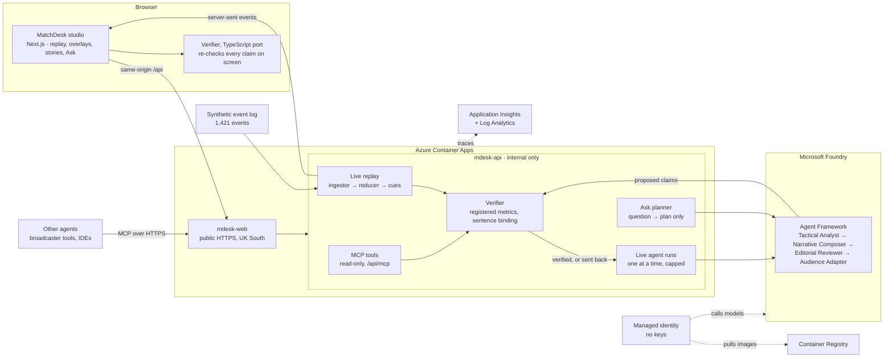

# MatchDesk
## AI agents draft the football story, code checks every claim, a producer decides

**Inside the Game hackathon entry · category: Best Multi-Agent System · owner: George Okwori**

| | |
| --- | --- |
| **Live demo** | https://mdesk-web.icybeach-62467e8a.uksouth.azurecontainerapps.io (Azure Container Apps: studio, API, live stream, live agent runs, MCP) |
| **Video** | _added with the submission_ |
| **Start here** | [Judging guide](docs/competition/judging-guide.md) · [Pitch](docs/competition/pitch.md) · [Architecture](#architecture) |

Broadcast and digital teams publish match statistics under time pressure, and a wrong number
goes out in seconds. A general-purpose AI makes that worse: it writes fluent sentences that
sound checked and are not. MatchDesk separates writing from truth. Four specialist agents on
Microsoft Foundry draft overlays, recaps and fan stories; a deterministic verifier recomputes
every number, and checks every sentence, against the event log before anything is shown; and
only a human producer can approve and publish. Everything runs on one invented match.


### Try it in three minutes

1. **Overview › Try to fool the verifier.** Claim 59% possession; the log says 57.96%, and the
   claim is rejected. Then see [hundreds more false claims it caught](#by-the-numbers).
2. **Live Intelligence.** Stream the match from the API at up to 60×; each overlay is verified on
   the server on the events received so far, and again in your browser. Switch to Español or
   the caption style, or open the **broadcast overlay** that OBS or vMix can load.
3. **AI Insights › Run it live now.** Four agents on Microsoft Foundry; watch the verifier send a
   claim back and the composer revise it (one live run every 5 minutes; a recorded run is always there).
4. **Audience Stories › Match recaps.** The half-time recap writes itself, every figure verified.
5. **Producer Tools.** Approve D-031's exact version, publish to a demo channel, retry the
   destination that times out; edit the draft and the approval is withdrawn.
6. **Connect an agent.** Point an MCP client (for example GitHub Copilot) at `/api/mcp` and ask
   it to check "Okafor scored 3 goals."


### By the numbers

| | |
| --- | --- |
| False claims caught | **810 of 810**, built from the 79 claims the demo shows, made wrong one way at a time: wrong number, player, team, half, statistic, evidence, scorer, card, substitute, gap or time ([results](docs/evidence/verifier-benchmark-20261024.md)) |
| True claims wrongly rejected | **0 of 295**, the originals and rewordings a reader would accept |
| Server and browser verifiers | Agree on every one of the 1,105 benchmark cases and 108 parity cases |
| Speed (one CPU in a cloud build container) | The whole replay ingested, reduced and verified in 0.4 s (about 3,500 events a second); each overlay or recap verified in about 1 ms (15 ms at most) when its window closes; all 79 claims re-verified in a browser engine in about 22 ms |
| Live agent runs on Foundry | 3 recorded evaluation runs: 6 claims passed first time, 2 were sent back (one wrong number, one sentence saying more than its claim), 3 malformed answers stopped before verification; no unverified claim reached an audience version |
| Tests | 1,658 Python tests, 216 studio unit tests, 246 browser tests on three screen sizes with axe accessibility checks, security and dependency CI on every pull request |


### What is real and what is synthetic

| Part | Status |
| --- | --- |
| The match | Synthetic: one invented match, 1,421 events. No real teams, players or footage |
| Metrics, verifier, overlays, recaps, stories | Real code, deterministic, run on that match |
| The four agents and the Ask planner | Real, on Microsoft Foundry through Agent Framework (live runs are rate-limited) |
| Tracking (shot speed, top speed, distance, sprints) | Modelled with the match, as a tracking provider would supply it; not measured from video |
| Auto-eventing | A detector reads events from a synthetic top-down video and is scored against the log |
| Spanish and French | AI-assisted templates, reviewed and corrected (77 corrections), certified by the owner; no native-speaker sign-off |
| Producer approval and publishing | A demo in the browser: no sign-in, no real destination |

What runs today, in more detail:

- Four specialist agents (Tactical Analyst, Narrative Composer, Editorial Reviewer,
  Audience Adapter) run end to end through role-scoped, traced tools. AI insights
  replays a live run recorded on Microsoft Foundry, step by step, beside the
  deterministic rehearsal.
- Every claim is recomputed from the event log, and the sentence itself is checked: it
  must name its subject and state the number it asserts. A failed claim goes back to
  the composer. The same verifier runs, ported exactly, in the browser.
- The match streams from the API on Azure, through the ingestor, reducer and verifier,
  with timed broadcast overlays, automated half-time and replay-point recaps, and fan
  stories for every goal, personalised by club, player, focus statistic, style and
  language (EN/ES/FR).
- An auto-eventing lab renders the synthetic match as video and reads the events back from the
  pixels, scored against the log ([method](labs/auto_eventing/README.md)).
- Other agents can use the same evidence and verifier through a read-only MCP endpoint
  (`/api/mcp`, [design](docs/design/mcp.md)).
- The submission build is `release/submission-2026-10`; a studio-only copy (no API) runs at
  https://matchdesk-seven.vercel.app. See the [release checks](docs/evidence/release-live-checks-20261023.md).

## What is implemented

The deterministic football engine now includes a seeded synthetic simulator,
ordered/idempotent replay ingestion, roster/score/possession reduction, eighteen registered
metric formulas (four of them over synthetic tracking: shot speed, top speed, distance
covered, sprints) and five explicit moment detectors. The Python API still distinguishes
structural validation from factual verification, and immutable contracts cover claims,
evidence, verification results and approval bindings.

Phase 2A adds a typed control plane for four specialist roles: Tactical Analyst,
Narrative Composer, Editorial Reviewer and Audience Adapter. The controller owns role
order, retry limits, timeout classification, bounded recovery and the verification
hand-off. It does not call a model and it does not give an agent publishing authority.
Later Phase 2 slices add evidence verification, scoped specialists, one bounded
live Foundry invocation and tested retry/recovery and model-evaluation controls.

The submission build has 1,658 Python tests, a 108-case Python/TypeScript verifier
parity fixture, a 1,105-case verifier benchmark run on both, and 246 studio browser tests
(three viewports, axe on every page).
Ruff, formatting, strict mypy, frontend build, dependency audit and source security
run in hosted CI on every pull request.

Ask MatchDesk is a question box in the studio. It guides people round the app and
answers questions about the match, and it shows the proof for every figure. The engine
writes every number: each factual sentence is built as a claim and checked by the
parity-tested verifier before it is shown. An optional Foundry planner, off by default,
may only translate a free-form question into a query plan. See
[the design](docs/design/ask-matchdesk.md).

Live Intelligence replays the log at 1× to 60× with statistics recomputed as the clock
moves and timed broadcast overlays whose claims are re-verified in the browser before they
appear. The same cues are published as a machine-readable feed,
[`/overlays/nbr-riv.json`](apps/web/src/app/overlays/nbr-riv.json/route.ts)
(schema `matchdesk-overlay-feed/1`, built by `matchdesk.domain.overlay_feed`), with every
persona (fan, analyst, caption), language (EN, ES, FR) and the full claim behind each
number, including the speed of each scoring shot and player tags when synthetic tracking
crosses a threshold (a sprint at 33 km/h, the first player on each side past 5 km).
Automated recaps at half-time and at the replay point
([`/recaps/nbr-riv.json`](apps/web/src/app/recaps/nbr-riv.json/route.ts), built by
`matchdesk.domain.recap_feed`) state the score, scorers, key figures and milestones, every
one a verified claim; the live stream sends each recap once its part of the match has
arrived. Viewers can pick a favourite club and player, a persona, a language and one focus
statistic; player-focus pages state each player's figures as verified sentences, and
Tactical Analysis labels each five-minute spell as control, chaos or contested, and lists
pressure changes, by published rules with the verified sentences that justify them.

PostgreSQL now has a reviewed producer-case migration, a pinned Psycopg driver,
real adapter qualification with a restricted disposable database role, atomic
audit/CAS/restart evidence, and independent validation of append-only audit rows
against the producer state snapshot. This does **not** qualify a production
database, Entra/OIDC authentication, host session grants or actual publication.
Independently accepted multilingual adaptations also remain outstanding.

Read [current progress](docs/PROGRESS.md) and the [evidence index](docs/evidence/INDEX.md)
before treating any capability as tested or available.

## Architecture


<details>
<summary>Diagram source (Mermaid)</summary>



</details>

Agents may only propose. Every figure that reaches a screen, an overlay or a story is a
structured claim the verifier recomputes from the event log, first on the server and again
in the browser; anything it cannot check is labelled as such, and only a producer may
publish. GitHub Actions builds both images from the exact commit and deploys with OIDC
([Azure demo](docs/operations/azure-demo.md)); a studio-only copy also runs on Vercel.

The [solution design](docs/solution-design/02-architecture.md) explains the deterministic, specialist, verification and producer trust boundaries, plus the later authenticated publication path.

## Reproduce the foundation

The hosted qualification uses Python 3.12.15, Node 22.16.0, npm 10.9.2 and uv 0.10.0.
Install these tools first, then reproduce the committed locks rather than generating
new dependency versions during setup. These instructions remain for isolated
development, not an approved production deployment:

```bash
make setup
uv run --no-sync make foundation
uv run --no-sync make lint
cd apps/web && npm run build
```

If uv cannot download Python 3.12.15 on your machine, run `make setup SETUP_PYTHON=3.12.13`
(or another 3.12 patch release uv offers); the lock is reproduced unchanged.
`make setup` rejects a stale Python lock; `npm ci` rejects a mismatched npm lock.
`make resolve` is a separate maintenance operation. Review its dependency changes
and run the full checks before committing. The [initial compatibility decision](docs/decisions/ADR-0005-build-compatibility.md)
remains historical. The [patched ASGI decision](docs/decisions/ADR-0007-patched-asgi-dependencies.md)
and [test-client correction](docs/evidence/asgi-upgrade-first-run-20261008.md) explain
the current dependencies without weakening warnings, types or test assertions.

## Try the implemented API

From the repository root after setup:

```bash
uv run --no-sync make api
# In another terminal:
curl http://127.0.0.1:8000/api/health
```

The event schema is at `/api/contracts/event`. POST a JSON event to
`/api/contracts/event/validate`. The response explicitly says `evidence_verified: false`.
`/api/ready` remains intentionally fail-closed because durable persistence, live models and
publication are not operational. The structural validator must not be mistaken for a
verified or production football-intelligence service.

## Local container topology

```bash
python -m scripts.create_local_env
make dev
```

Use WSL2 or another POSIX shell with Docker. The environment generator creates a
local secret without printing or replacing it; do not commit `.env`. API and web
ports bind only to loopback, and PostgreSQL has no host port. New database volumes
initialise TCP authentication with SCRAM. Existing volumes need a separately reviewed
authentication migration; do not delete a database merely to apply these settings.

The standalone web image compiles its non-secret API upstream during the build.
Unused pip/npm/Yarn/Corepack are excluded from the final service images, not the
build stages. Image inventories and actual runtime/browser tests check the result;
The qualified native-image gate currently passes on the tested source. The
[integration method](docs/testing/integration-foundation.md) and
[image-security method](docs/testing/runtime-image-security.md) explain the scope.
The public demo runs on Azure Container Apps from the images CI builds; see the
[Azure demo](docs/operations/azure-demo.md).

## Tests, comments and documentation

`make foundation` runs regression tests, schema-drift checks, documentation link checks
and Python docstring-presence checks. `make lint` runs Ruff, formatting, strict mypy
and frontend type checks. Independent integration, advisory and source-security workflows
retain failures, source IDs, hashes, JUnit, screenshots, SARIF and redacted scan reports.
The [evidence index](docs/evidence/INDEX.md) separates historical image-security failures from later passing qualifications and the current Phase 3A/3B evidence.

Every authored Python module, class and function has a docstring. Non-obvious
validation, concurrency and security decisions have explanatory comments. Browser
helpers, controlled fixtures, container definitions and CI steps document their intent.
TypeScript includes compile-time regression checks for the platform declarations
used by Next.js. See the [coding standard](docs/engineering/coding-standard.md).

## Navigation

[Project specification](docs/project-specification.md) · [Project story](docs/project-story.md)
· [Testing strategy](docs/testing/test-strategy.md) · [Operations](docs/operations/runbook.md)
· [Requirements traceability](docs/competition/traceability-matrix.md)
· [Foundation merge checklist](docs/operations/foundation-merge-checklist.md)
· [Repository controls for review](docs/operations/repository-controls.md)

## Data, AI and licence

All supplied example data is invented. No real match footage, team branding or
player likeness is included. Synthetic xG is an illustrative estimate, not a
calibrated professional model. Runtime agents and their limits remain explicit in the
[responsible-AI design](docs/solution-design/12-responsible-ai.md). Live Foundry runs are started on demand in the Azure demo, five minutes apart and at
most twelve a day; this is not an always-on model service.

Original project source is provided under the [MIT licence](LICENSE).
