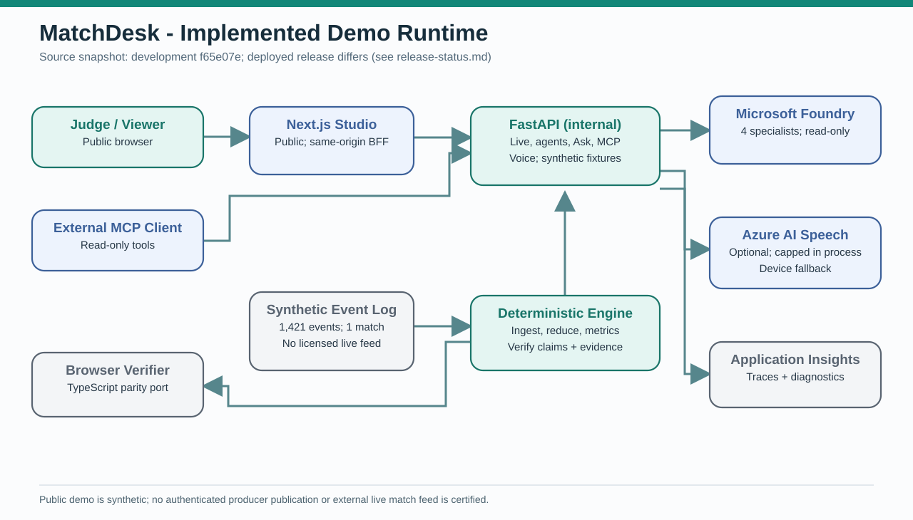
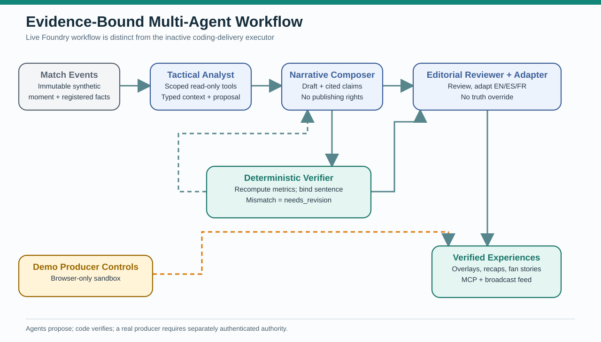
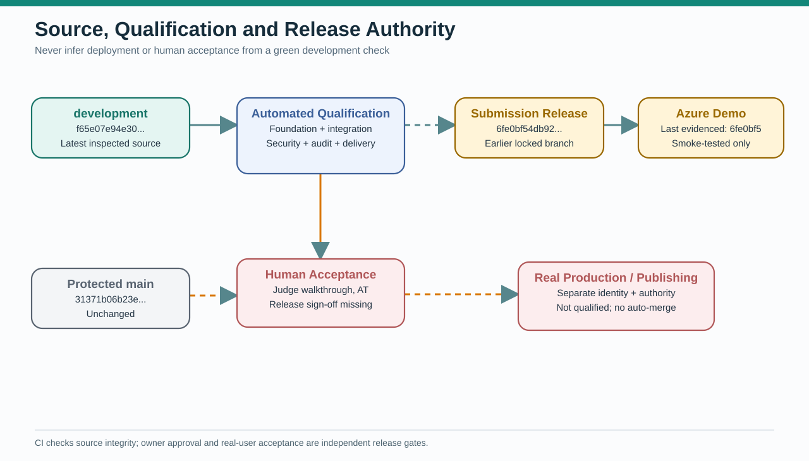

# Architecture diagram register

These are **rendered, self-contained SVG diagrams** with editable Mermaid companion
sources. SVGs render directly in GitHub's Markdown preview; Mermaid files are
source-level system maps. They are maintained as paired conceptual representations,
not pixel-exact exports of the Mermaid syntax.

| Rendered visual | Editable description | Meaning |
| --- | --- | --- |
|  | [Mermaid source](runtime-implemented.mmd) | Implemented synthetic Azure demo boundaries and host options |
|  | [Mermaid source](agent-verification-implemented.mmd) | Specialist proposals, deterministic truth gate, presentation |
|  | [Mermaid source](release-authority-implemented.mmd) | Automated evidence versus deployed revision and human decisions |

The three SVGs are authored to be readable at standard GitHub document width.
They are **not proof that the Azure deployment is running the latest development code**.
See [release ledger](../operations/release-status.md) and
[implementation inventory](../implementation-inventory.md).

## Existing architecture figures

The older PNGs are retained for traceability. Their associated design chapters
may show planned architecture, including proposed production identity and data flow.
Treat these as dated historical perspectives, not the current hosted demonstration.
