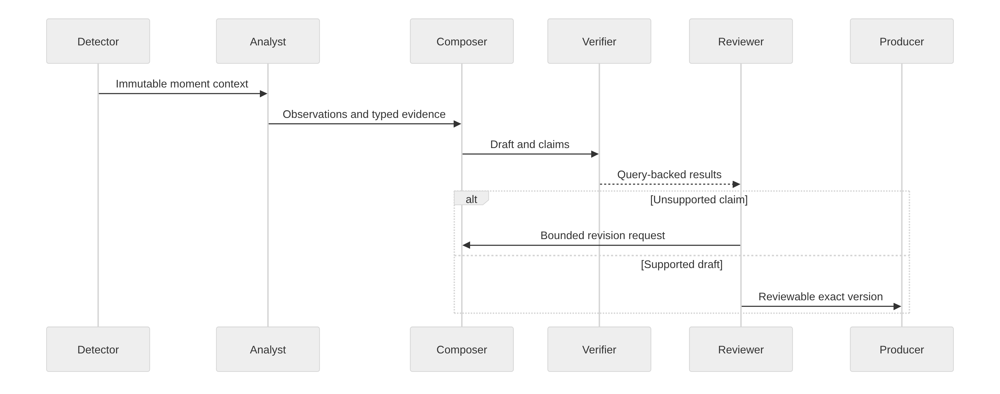
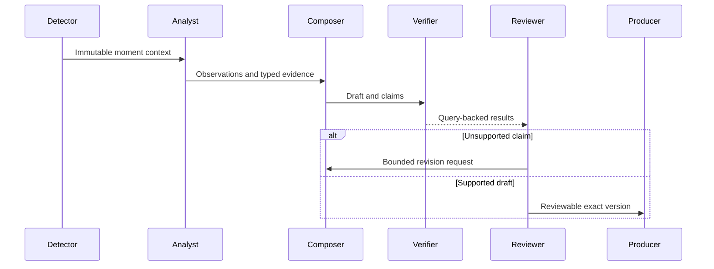

# Runtime agents and orchestration

Status (26 October 2026): a four-specialist workflow runs through Microsoft Agent Framework on Microsoft Foundry in the Azure competition demo, with role-scoped read tools, bounded retries, deterministic claim verification and recorded evidence. A recorded run and deterministic rehearsal are also available. See the [judging guide](../competition/judging-guide.md), [competition build record](../evidence/competition-build-20261022.md) and [requirements traceability](../competition/traceability-matrix.md).

| Specialist | Responsibility | Authority |
|---|---|---|
| Tactical Analyst | Interpret moment context and identify observations/inferences | Read-only events and registered metrics |
| Narrative Composer | Produce sentence-to-claim mapped narrative variants | Draft text only |
| Editorial Reviewer | Review wording and use deterministic verifier outcomes | Request revisions, never override numerical checks |
| Audience Adapter | Adapt tone and language while preserving facts | New draft versions requiring fresh verification |

Diagram source (Mermaid)

The controller (not the model) enforces role order, time and revision budgets, and verification handoffs. The documented live runs include malformed proposals blocked by the claim contract, unsupported claims sent back for revision, and a revision-budget exhaustion that withheld a claim. These runs do not establish durable crash recovery of an in-flight live workflow; that requires external workflow-state persistence and recovery qualification. Specialist requests
include a correlation ID, replay identity, model/prompt versions and bounded token budget.

Fallback output may use labelled factual templates only when the underlying facts have passed deterministic checks. Recorded model responses and deterministic rehearsals remain visibly distinct from newly triggered live inference. The hosted live-run path is rate-limited and cost-capped; model and SDK changes require separate qualification.

Reference checked 8 October 2026: [Microsoft Agent Framework overview](https://learn.microsoft.com/en-us/agent-framework/overview/).
